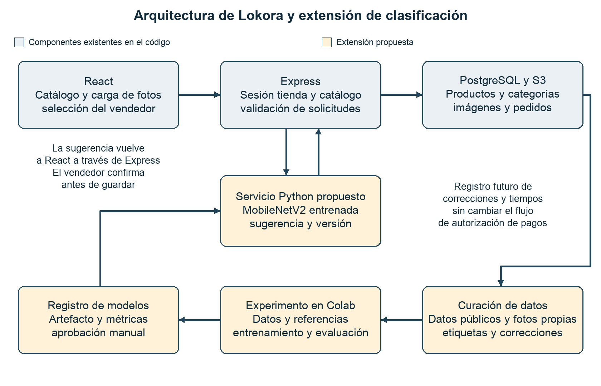

# Proyecto final: clasificación visual de productos para Lokora

**Avance I (R2-A3-S11). Definición del problema**

Universidad de Cundinamarca. Posgrado. Aplicaciones en Deep Learning (608145)
Docente: Wilson Mauro Rojas Reales
Estudiante: Harold Duque (trabajo individual)
Fecha: 17 de noviembre de 2026

## Resumen

Se propone una extensión de Lokora, una plataforma de comercio desarrollada en la hackatón de Open Payments (Medellín, 16 y 17 de octubre de 2026), que sugiere la categoría de un producto a partir de su fotografía. El vendedor confirma o corrige la sugerencia antes de guardar. La solución usa MobileNetV2 con aprendizaje por transferencia y se compara con dos referencias sencillas. Este documento define el problema, revisa cinco trabajos y describe el diseño de la solución. Los resultados experimentales se presentan en el Avance III.

# Avance I. Definición del problema

## 1. Contexto real y problema

Un comercio que publica productos en Lokora debe cargar fotografía, descripción y categoría de cada referencia. Cuando la categoría se asigna a mano, el tiempo de publicación crece con el número de productos y pueden aparecer criterios inconsistentes entre vendedores. La aplicación ya almacena una categoría por producto y administra sus imágenes, lo que permite incorporar una asistencia visual durante la carga.

**Aplicación original.** Video de la aplicación de Lokora en funcionamiento: https://youtube.com/shorts/1stYAlFeCe8

**Pregunta de investigación.** ¿Puede un modelo de clasificación de imágenes sugerir correctamente una de tres categorías (frutas, verduras, envasados) con calidad suficiente para ayudar al vendedor?

**Alcance.** Una fotografía con un producto principal y tres categorías. Panadería, artesanías, experiencias y productos mixtos se registran manualmente. La clasificación no interviene en pagos.

**Cómo se mide el impacto.** El proyecto debe poder medir el efecto, como pidió el docente. Se compararán el tiempo de carga manual y asistida y la tasa de correcciones del vendedor. Este ahorro no está medido todavía y no se afirma un porcentaje.

**Disponibilidad de datos.** Hay datos históricos públicos (Grocery Store Dataset) para entrenar. Las fotografías propias de comercios de Lokora no existen aún; se recolectarán después para medir el cambio de dominio.

## 2. Objetivos

**General.** Diseñar y evaluar una extensión reproducible de clasificación visual para Lokora, comparando MobileNetV2 con referencias sencillas.

**Específicos.**

1. Preparar un conjunto con etiquetas, procedencia y particiones fijas.
2. Comparar modelos con macro-F1 y errores por clase.
3. Registrar datos, código, parámetros y modelos de cada ejecución.
4. Definir el flujo en que el vendedor confirma la sugerencia.
5. Medir en un piloto el tiempo de carga y las correcciones.

## 3. Revisión de literatura y análisis comparativo

Se revisaron cinco trabajos. Los datos bibliográficos se verificaron en arXiv. Las descripciones se basan en los resúmenes de los artículos, no en una lectura completa; las cifras de resultados de cada uno deben citarse del texto original antes de la entrega final.

| Trabajo | Aporte | Datos y entrada | Relación con Lokora |
|---|---|---|---|
| Klasson, Zhang y Kjellström (2019). *A Hierarchical Grocery Store Image Dataset with Visual and Semantic Labels*. WACV. | Conjunto de fotografías de frutas, verduras y lácteos y jugos refrigerados tomadas con smartphone en 18 tiendas; 46 clases gruesas y etiquetas jerárquicas. | Imágenes naturales de tienda | Es la fuente de datos del piloto. Su dominio (fotos de teléfono en tienda) se parece al de un vendedor, pero no es el de Lokora. |
| Sandler et al. (2018). *MobileNetV2: Inverted Residuals and Linear Bottlenecks*. CVPR. | Arquitectura móvil eficiente con bloques residuales invertidos y cuellos de botella lineales. | Imágenes de 224 × 224 | Es el modelo elegido: pequeño, rápido y apto para servir sugerencias con baja latencia. |
| Tan y Le (2019). *EfficientNet: Rethinking Model Scaling for Convolutional Neural Networks*. ICML. | Escalado compuesto de profundidad, ancho y resolución. | Imágenes de resolución variable | Alternativa de mayor precisión y mayor costo. Se deja como mejora futura si MobileNetV2 resulta insuficiente. |
| Zahavy et al. (2016). *Is a picture worth a thousand words? A Deep Multi-Modal Fusion Architecture for Product Classification in e-commerce*. | Fusión de texto e imagen para clasificar productos de comercio electrónico con muchas categorías. | Imagen y título del producto | Muestra que el texto aporta información. Lokora tiene nombre y descripción del producto, así que se propone como extensión. |
| Gross et al. (2025). *Cross-Platform E-Commerce Product Categorization and Recategorization: A Multimodal Hierarchical Classification Approach*. | Clasificación multimodal y jerárquica con RoBERTa, ViT y CLIP sobre 271.700 productos de 40 plataformas. | Imagen y texto | Respalda el uso de imagen y texto y la jerarquía de categorías; su escala excede la de este piloto. |

**Análisis comparativo.** Los dos primeros trabajos definen el piloto: datos de fotos reales en tienda y un modelo liviano. EfficientNet ofrece más capacidad a mayor costo, y la decisión entre ambos debe tomarse con la validación, no por preferencia. Los dos trabajos de comercio electrónico usan imagen y texto, con muchas más categorías y datos que este proyecto. Por eso el piloto parte solo de imagen y tres clases, y la fusión con texto queda como evolución.

## 4. Diseño de la solución

**Modelo.** MobileNetV2 preentrenada en ImageNet, con la base congelada y una cabeza nueva: pooling global, dropout de 0,2 y capa softmax de tres salidas. Optimizador Adam (tasa 0,001), lotes de 32, máximo 20 épocas y parada temprana tras cuatro épocas sin mejora en la pérdida de validación. Son valores iniciales, no resultado de una búsqueda.

**Referencias de comparación.** (a) predecir siempre la clase más frecuente; (b) regresión logística sobre 54 atributos de histograma de color RGB. Si la red no supera estas referencias en validación, no se justifica usarla.

**Métrica principal.** Macro-F1, porque da el mismo peso a las tres clases. También exactitud, precisión y recall por clase, matriz de confusión y latencia. Meta exploratoria de macro-F1 de prueba ≥ 0,80, que no es un resultado alcanzado.

**Herramientas.** Python, TensorFlow/Keras, scikit-learn, Google Colab para el entrenamiento, GitHub para el código.

**Arquitectura de integración.** La figura 1 distingue la aplicación original (React y Express) del servicio de inferencia en Python propuesto. El servicio expone `POST /predict-category`, recibe una imagen (hasta 5 MB) y devuelve categoría, puntuaciones, versión y tiempo. El vendedor confirma desde la interfaz antes de guardar; si el servicio no responde, se registra manualmente.

## Referencias

[1] Klasson, M., Zhang, C. y Kjellström, H. (2019). A Hierarchical Grocery Store Image Dataset with Visual and Semantic Labels. IEEE Winter Conference on Applications of Computer Vision (WACV). https://arxiv.org/abs/1901.00711

[2] Sandler, M., Howard, A., Zhu, M., Zhmoginov, A. y Chen, L.-C. (2018). MobileNetV2: Inverted Residuals and Linear Bottlenecks. CVPR. https://arxiv.org/abs/1801.04381

[3] Tan, M. y Le, Q. V. (2019). EfficientNet: Rethinking Model Scaling for Convolutional Neural Networks. ICML. https://arxiv.org/abs/1905.11946

[4] Zahavy, T., Magnani, A., Krishnan, A. y Mannor, S. (2016). Is a picture worth a thousand words? A Deep Multi-Modal Fusion Architecture for Product Classification in e-commerce. https://arxiv.org/abs/1611.09534

[5] Gross, L., Walter, R., Zoppi, N., Justus, A., Gambetti, A., Han, Q. y Kaiser, M. (2025). Cross-Platform E-Commerce Product Categorization and Recategorization: A Multimodal Hierarchical Classification Approach. https://arxiv.org/abs/2508.20013

[6] Axiom. Lokora, proyecto de la hackatón Open Payments, Medellín, 16 y 17 de octubre de 2026. Video de la aplicación: https://youtube.com/shorts/1stYAlFeCe8

[7] Keras. Transfer learning and fine tuning. https://keras.io/guides/transfer_learning/
