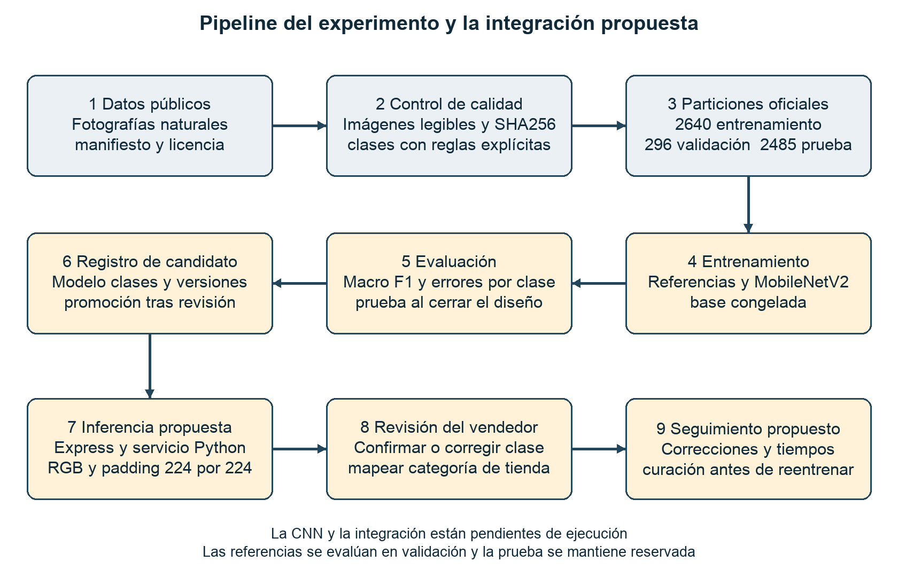

# Proyecto final: clasificación visual de productos para Lokora

**Avance II (R2-A3-S12). Pipeline**

Universidad de Cundinamarca. Posgrado. Aplicaciones en Deep Learning (608145)
Docente: Wilson Mauro Rojas Reales
Estudiante: Harold Duque (trabajo individual)
Fecha: 17 de noviembre de 2026

## Resumen

Este documento describe el pipeline del proyecto: de dónde provienen los datos, cómo se preprocesan y cómo se organiza el repositorio. El problema y el diseño de la solución se encuentran en el Avance I. Los resultados del entrenamiento de la red se presentan en el Avance III.

# Avance II. Pipeline

## 5. Diagrama del flujo de datos

La figura 2 muestra el flujo desde las fotografías hasta el uso propuesto, con los artefactos que conserva cada ejecución.

## 6. Recolección de datos y fuentes

| Fuente | Contenido | Licencia | Estado |
|---|---|---|---|
| Grocery Store Dataset (Klasson et al., 2019). https://github.com/marcusklasson/GroceryStoreDataset | Fotografías de frutas, verduras y productos envasados con listas oficiales de entrenamiento, validación y prueba | MIT | Descargado y preparado |
| Fotografías propias de comercios de Lokora | Productos reales con categoría confirmada | Propia | Pendiente de recolección |
| Correcciones del vendedor | Sugerencia frente a categoría final | Propia | Se generará en el piloto |

Se usan solo las fotografías naturales. Las imágenes icónicas y las descripciones del conjunto quedan fuera. Las carpetas Fruit, Vegetables y Packages se mapean a `frutas`, `verduras` y `envasados`; el tomate sigue la convención del conjunto y se etiqueta como verdura.

| Categoría | Entrenamiento | Validación | Prueba |
|---|---:|---:|---:|
| Envasados | 864 | 100 | 781 |
| Frutas | 1.142 | 111 | 1.117 |
| Verduras | 634 | 85 | 587 |
| **Total** | **2.640** | **296** | **2.485** |

## 7. Preprocesamiento

1. Lectura respetando la orientación EXIF y conversión a RGB.
2. Redimensión con relleno a 224 × 224 píxeles.
3. Escalado de 0–255 a -1–1, aplicado una sola vez dentro del modelo.
4. Aumento de datos solo durante el entrenamiento.
5. Manifiesto con ruta, clase, partición oficial, fuente, licencia y SHA-256. No se encontraron duplicados exactos; esto no descarta fotos visualmente parecidas.

**Límite de independencia.** Los metadatos no identifican el objeto físico ni la sesión de captura, así que no se puede afirmar separación por producto. Con fotos propias se agruparán por producto o sesión, de modo que un grupo quede en una sola partición.

## 8. Resultados disponibles al corte

Esta sección recoge las referencias de comparación, evaluadas sobre las 296 fotografías de validación. La evaluación de MobileNetV2 y de la partición de prueba se reporta en el Avance III.

| Modelo | Exactitud (validación) | Macro-F1 (validación) | Estado |
|---|---:|---:|---|
| Clase más frecuente | 0,3750 | 0,1818 | Ejecutado |
| Histograma RGB y regresión logística | 0,5304 | 0,5136 | Ejecutado |

## 9. Repositorio y reproducibilidad

Repositorio en GitHub: https://github.com/HaroldDuke/lokora-clasificacion-productos

El repositorio está organizado en `ml/` (código), `notebooks/`, `config/`, `datos/` (plantillas), `resultados/`, `diagramas/` y `docs/`, e incluye un README con instalación, uso y dependencias. El antecedente de la aplicación pertenece al equipo Axiom (https://github.com/cataia-code/interledger-axiom-hackathon); esta extensión es un trabajo académico individual.

## 10. Siguientes pasos

| Entrega | Contenido |
|---|---|
| 23 de noviembre (Avances III y IV) | Entrenar MobileNetV2 en Colab, comparar con las referencias, analizar errores y evaluar en prueba una sola vez |
| 25 de noviembre (Avance V y proyecto final) | Evaluación con fotografías propias, flujo de confirmación y medición de tiempo y correcciones |

## Referencias

[1] Klasson, M., Zhang, C. y Kjellström, H. (2019). A Hierarchical Grocery Store Image Dataset with Visual and Semantic Labels. IEEE Winter Conference on Applications of Computer Vision (WACV). https://arxiv.org/abs/1901.00711

[2] Sandler, M., Howard, A., Zhu, M., Zhmoginov, A. y Chen, L.-C. (2018). MobileNetV2: Inverted Residuals and Linear Bottlenecks. CVPR. https://arxiv.org/abs/1801.04381

[6] Axiom. Lokora, proyecto de la hackatón Open Payments, Medellín, 16 y 17 de octubre de 2026.

[7] Keras. Transfer learning and fine tuning. https://keras.io/guides/transfer_learning/
